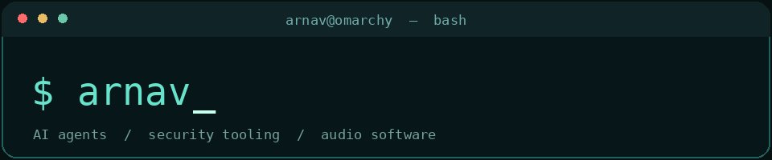

**AI Systems Engineer · Cybersecurity Tooling · Full-Stack Developer · Audio Software Founder**

I build **local-first AI agents**, developer automation, security research tools, and creative software — from autonomous tool-using LLM workflows to real-time C++ audio plugins.

[GitHub](https://github.com/arnav42069) · [Azazel Audio](https://azazelaudio.com) · [Footyhunt](https://footyhunt.com) · [LinkedIn](https://www.linkedin.com/in/as999/)

---

## Currently building

- **BlackBox:** A lightweight, local-first **Ollama-powered penetration-testing harness** for explicitly authorized labs and owned environments. Designed around an iterative **reason → tool → observe** execution loop, transparent terminal activity, scoped network/web tools, SSH-based inspection with authorized access, and model-aware image input.
- **Autonomous BlackBox QA Orchestrator:** An AI-assisted **development–test–inspect–repair** workflow for BlackBox. It coordinates iterative code changes, test results, diagnostics, and follow-up development tasks to reduce manual context-switching between coding agents and QA. *An evolving personal engineering workflow.*
- **Local LLM infrastructure:** Running and evaluating Qwen-family and other open-weight models using **Ollama** on Linux, experimenting with quantization, VRAM constraints, tool calling, context windows, prompt design, and agent reliability.
- **Azazel Audio:** Developing native **C++/JUCE** audio plugins and the full-stack infrastructure used to distribute them.

> I’m particularly interested in the intersection of **agentic AI, offensive-security workflows with explicit authorization, sandboxed tool execution, and developer productivity**.

## Featured engineering projects

| Project | What I'm building | Stack / focus |
| :--- | :--- | :--- |
| **BlackBox** | Local LLM agent harness for scoped security-lab workflows, tool invocation, execution logs, and multimodal assistance | Python, Ollama, Linux, cybersecurity tooling |
| **Autonomous BlackBox QA Orchestrator** | Iterative agent-assisted coding and QA: issue reproduction, testing, feedback, and repair cycles | Codex, automation, test orchestration, Linux |
| **[Azazel Audio](https://azazelaudio.com)** | Audio plugin products and a direct-to-customer software storefront | C++, JUCE, DSP, React, Vercel |
| **[Footyhunt](https://footyhunt.com)** | Football match discovery and coordination platform | Full-stack web engineering, product design |
| **[WordForge](https://github.com/arnav42069/WordForge)** | Context-aware wordlist generator for authorized auditing and CTF/lab use, with optional local-model integration | Python, Tkinter, Ollama |

## BlackBox: local AI for security workflows

BlackBox is my specialized harness for running local models with *real tools* rather than treating a chatbot response as execution. The system is being developed around:

- **Local-first inference:** Ollama-backed models without a required cloud inference dependency.
- **Tool-use architecture:** Multi-step agent loops that observe the results of actual tool calls.
- **Scoped security tooling:** Workflows for authorized host discovery, web inspection, and lab investigations.
- **Visibility and controls:** Command/output logs, bounded execution, cancellation, and explicit target-scope handling.
- **Multimodal usability:** Screenshot input and an Omarchy BlackTurq-inspired terminal interface.

The **QA Orchestrator** is the next layer: using agent-driven iteration to move from a bug report or screenshot to an implementation change, verification, and another development pass. I’m exploring how to make this repeatable while retaining inspectable logs and clear human control over scope.

*Note: BlackBox and the orchestrator are active development projects; the items above describe their intended architecture and development focus, not a claim of independently audited or production-hardened security software.*

## Azazel Audio

I'm the founder and developer of **[Azazel Audio](https://azazelaudio.com)**, building software for music producers who want precise control without sacrificing creative flow.

### SuckerPunch — kick synthesis

A kick drum synthesizer built around waveform editing, pitch and amplitude shaping, transient control, and visual sound-design workflows for house, techno, psytrance, and electronic music.

### VisualComp — visual dynamics processing

A visually driven dynamics processor combining compression workflows with interactive EQ and real-time signal feedback. Built using **C++ and JUCE**, with an emphasis on clear DSP visualization and usability.

My work spans **real-time audio programming, DSP, interface design, plugin builds, releases, and web commerce**.

## Technical toolkit

| Area | Technologies & practices |
| :--- | :--- |
| **AI / agents** | Ollama, local LLM inference, Qwen-family models, tool calling, agent loops, prompt engineering, model evaluation, Codex |
| **Cybersecurity** | Linux, authorized penetration-testing labs, network enumeration, web security tooling, SSH, scope-aware automation |
| **Software engineering** | Python, C++, JavaScript, Java, PHP, SQL, Git, Bash, API integration, test-driven debugging |
| **Web / platforms** | React, Node.js, Express, MySQL, MongoDB, REST APIs, Vercel |
| **Audio / systems** | JUCE, VST3, digital signal processing, real-time waveform visualization, synthesis |
| **Environment** | Omarchy (Arch Linux), Hyprland, Wayland, Docker/virtualization workflows |

## Background

Previously, I developed bespoke ERP and operational software at **Capital Cigar** and **InterioNova**, working across database architecture, process automation, and business-facing product development.

- **A.S. Computer Science** — Northern Virginia Community College
- **Professional Certificate in Cybersecurity** — MIT xPRO

## Outside the terminal

I produce electronic music, experiment with sound design, and enjoy football. Building tools for creators and making complicated systems easier to use are recurring themes in my work.

---

**Build locally. Automate thoughtfully. Verify everything.**

[Explore Azazel Audio](https://azazelaudio.com) · [See my repositories](https://github.com/arnav42069?tab=repositories)

